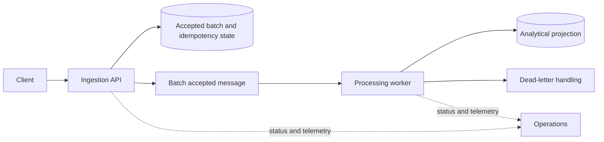

# End-to-End Event-Driven Data Platform

This worked example follows one synthetic scientific data batch from stakeholder need to specification, the six Delivery Framework stages, code, deployment, and operations. It uses the existing [event-driven data platform design](../../specifications/data-platform/event-driven-data-platform-design.md) as its starting specification.

The specification describes a local educational lab and explicitly leaves real AWS deployment, production availability, and real analytical services out of scope. Therefore this guide separates the executable local learning path from a later AWS deployment design. AWS service names are candidates to evaluate, not a selected production architecture.

## Follow the walkthrough

1. [Specification and scope](01-specification.md)
2. [Delivery Framework walkthrough](02-delivery-framework-walkthrough.md)
3. [AWS architecture by responsibility](03-aws-architecture-by-category.md)
4. [Code and testing path](04-code-and-testing.md)
5. [Deployment and operations path](05-deployment-and-operations.md)
6. [Evolution and production readiness review](06-evolution-and-review.md)

## Starting scenario

A client submits a batch of measurements. The API validates it and responds with acceptance without waiting for analytical processing. A worker processes the batch asynchronously, stores a result, and exposes enough status and telemetry for an operator to investigate retries or failures.

The diagram is a conceptual flow: the local implementation uses adapters such as FastAPI, a local queue, and SQLite; AWS equivalents are discussed separately.
