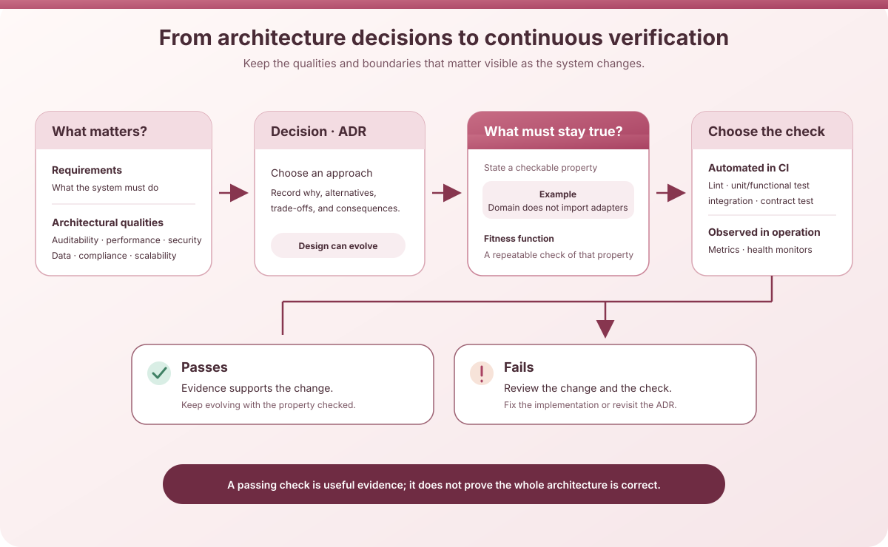

# Evolutionary Architecture and Engineering Practices

Software architecture and the team's development process are related, but they answer different questions. The **development process** describes how people organize and coordinate work (for example, roles, planning, meetings, and workflow). **Engineering practices** are repeatable techniques for building and changing software, such as automated testing, continuous integration, and deployment automation. A team can use these practices within different processes; the process alone does not guarantee that the system is well engineered.

Architecture should account for how the system will be built and operated. Some architectural styles depend on supporting practices: for example, independently deployed services are harder to operate safely without automated deployment, monitoring, and contract checks. Choose practices that support the architecture and the team's actual needs; do not adopt distributed architecture or a named process just to demonstrate a technique.

Designs also change as teams learn about requirements, implementation, and operations. An **evolutionary architecture** allows that change while keeping important qualities and boundaries intact. Instead of assuming that a design can anticipate every future condition, identify the properties that matter and check them regularly as the system evolves.

## Principles and decisions

A **design principle** is guidance for making choices in context; an **architecture decision** is a specific choice or constraint for this system. For example, “keep domain rules independent of infrastructure” is a principle, while “domain modules must not import database adapters” is a checkable rule derived from it. Use the existing [design principles reference](design-principles-and-anti-patterns.md) for general heuristics and an [ADR](../artifacts-and-templates/architecture-decision-record.md) to explain consequential system-specific decisions.

When a constraint does not fit a real case, record the reason and consequences with the decision, then review whether the rule still serves its purpose. If a rule must remain true as the system changes, consider a fitness function to check it. This keeps guidance flexible while making important constraints visible and reviewable.

## Architectural fitness functions

An **architectural fitness function** is an objective, repeatable check that gives evidence about whether an architectural characteristic or constraint is being preserved. It is a broad term, not a specific framework or a single kind of test. A fitness function can be an automated test, static analysis rule, contract check, metric, or operational monitor. It is most useful when it runs often enough to catch drift while a change is still easy to correct.

The test category does not determine whether something is a fitness function. A unit, functional, integration, or contract test qualifies when it checks an architectural property or quality that the team intends to preserve. For example, an integration test that only checks one use case is useful testing, but it is not automatically an architectural fitness function. A contract test that enforces event compatibility can be one.

Examples for this lab include:

- A dependency rule or static check verifies that domain modules do not import database, web-framework, or transport adapters.
- Contract tests verify that an event producer and its consumer agree on required fields and compatibility expectations.
- A module-boundary check detects imports that cross a declared layer or module boundary.
- A measured latency or error-rate check can track a quality goal once the project defines a representative workload and an acceptable target.

The first three can be automated as the relevant code and contracts exist. The final example needs a project-specific workload and threshold; do not invent one. A check only provides useful evidence if its scope, assumptions, and response to failure are clear. A passing check does not prove the entire architecture is correct, and not every design concern can or should be reduced to a number.

Use fitness functions selectively: start with important qualities or boundaries identified in requirements and design, then choose the least costly check that can detect their erosion. Run automated checks locally or in continuous integration (CI), commonly on each proposed change. CI can report or block on failure according to the project's policy. Continuous delivery/deployment (CD) may use checks as release gates, but fitness functions do not require CD. For consequential decisions, record the property and its check in the optional verification section of the [ADR](../artifacts-and-templates/architecture-decision-record.md). See the [engineering workflow](../engineering-workflow/README.md) for team practices and the [Delivery Framework](../delivery-framework/README.md) for the stages where requirements, boundaries, and risks are identified.
